# SchemeSetu

**Bridging You to the Benefits You Deserve.**
Discover scholarships and welfare schemes made for you.

SchemeSetu is a full-stack web application that helps students and citizens in India discover government
scholarships and welfare schemes, understand **why** they may or may not be eligible, prepare the required
documents, track deadlines and keep a personal record of their applications.

> SchemeSetu is an independent discovery tool built as a Web Technology course project. It is **not** an
> official government portal, does not submit applications, and its eligibility results are preliminary.

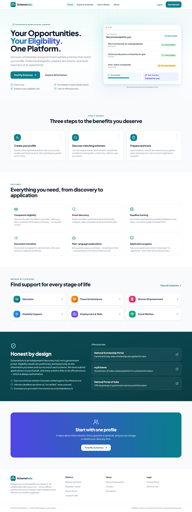

---

## Contents

- [Features](#features)
- [Screenshots](#screenshots)
- [Tech stack](#tech-stack)
- [Architecture](#architecture)
- [Getting started (local)](#getting-started-local)
- [Environment variables](#environment-variables)
- [Database & seed data](#database--seed-data)
- [Testing](#testing)
- [Deployment](#deployment)
- [API documentation](#api-documentation)
- [Folder structure](#folder-structure)
- [Team & contributions](#team--contributions)
- [Known limitations](#known-limitations)
- [License](#license)

## Features

| # | Feature | What it does |
|---|---------|--------------|
| 1 | **Accounts & secure sessions** | Register, log in and log out. Passwords are hashed with bcrypt. Sessions use short-lived JWT access tokens and rotating refresh tokens in HttpOnly cookies, with CSRF protection. |
| 2 | **Eligibility profile** | A four-step onboarding wizard where every question is optional and "Prefer not to say" is always available. It never asks for Aadhaar, bank or certificate data. |
| 3 | **Rule-based eligibility engine** | Deterministic, explainable three-valued logic (PASS / FAIL / UNKNOWN) with nested AND/OR groups and income-bracket interval maths. Missing data never counts as a failure. |
| 4 | **Personalised dashboard** | Likely-eligible and needs-more-info counts, recommendations, upcoming deadlines, profile completeness, recent activity and an application chart. Every number comes from the database. |
| 5 | **Scheme explorer** | Public search plus filters (category, state, education, provider, benefit, eligibility, deadline, verified-open), sorting and server-side pagination, all synced to the URL. |
| 6 | **Scheme details** | Benefits, a criterion-by-criterion eligibility breakdown, documents, steps, dates, source and verification status. |
| 7 | **Saved schemes** | Bookmarks are stored in MongoDB, with duplicates prevented by a unique index. They can be searched. |
| 8 | **Deadline tracker** | Upcoming, expired and unverified deadlines with a month calendar, counted in IST. A scheme is never called "open" unless an admin verified it. |
| 9 | **Document checklist** | Tick off documents as you prepare them. Progress uses stable document ids, so it survives admin edits. Nothing is uploaded. |
| 10 | **Application tracker** | Eight statuses, applied date, notes, status history and a stepper. It is explicitly user-maintained. |
| 11 | **Admin CMS** | Stats, a scheme table with search and filters, create/edit/delete, publish/unpublish, verification dates and a visual AND/OR rule builder with a JSON mode. RBAC is enforced on the server. |

Supporting features include account deletion, accessible modals, keyboard navigation, reduced-motion
support, responsive layouts with a mobile menu and filter sheet, loading/empty/error states everywhere,
and route-level code splitting.

## Screenshots

These were captured automatically from the running app by the Playwright suite (`npm run screenshots`).

| | |
|---|---|
| 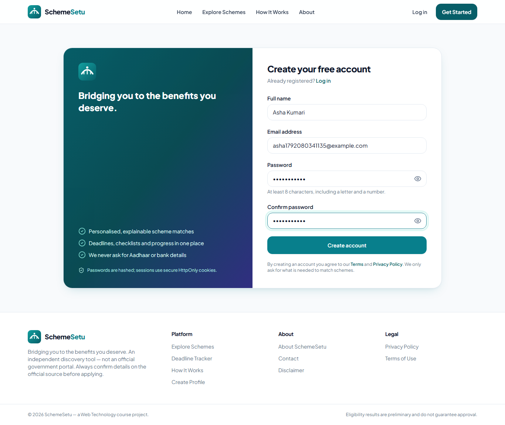 Register | 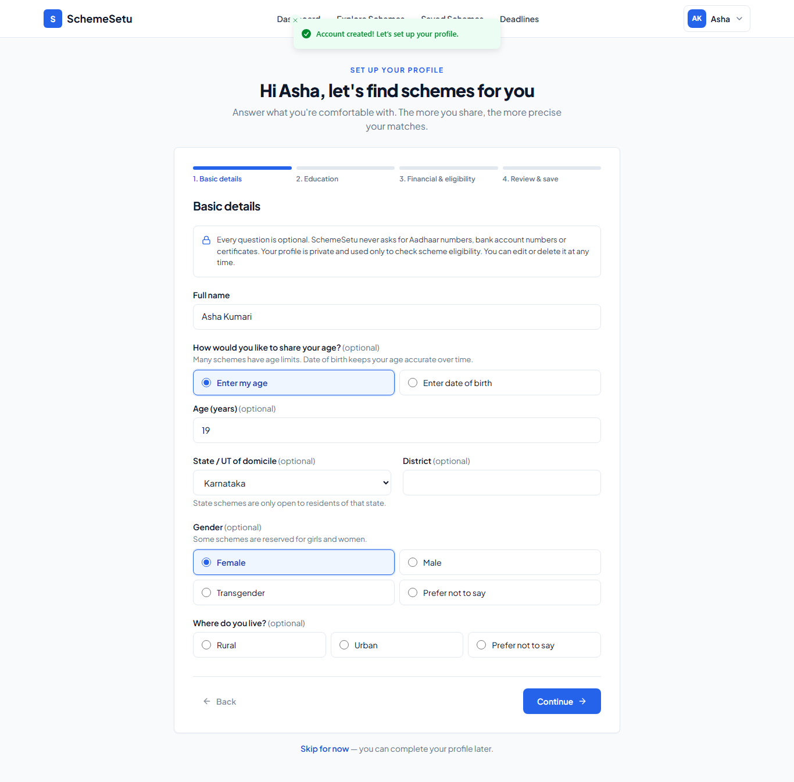 Profile onboarding |
| 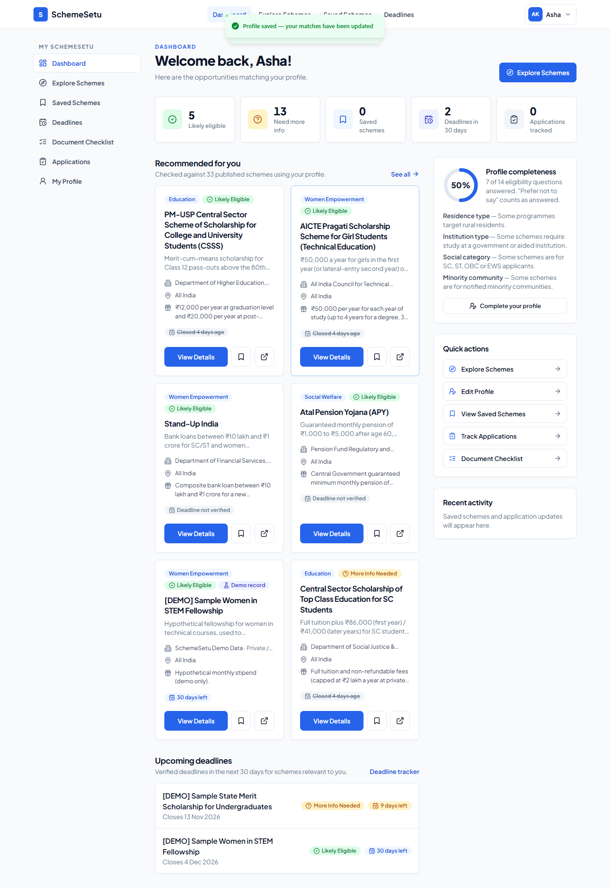 Dashboard | 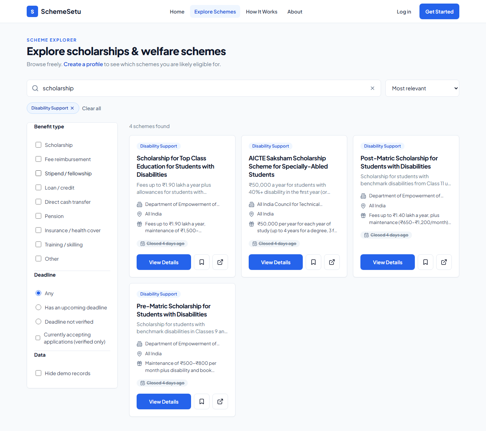 Scheme explorer |
| 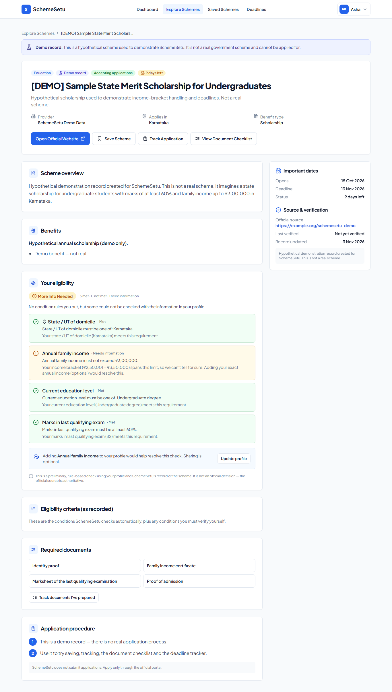 Scheme details & eligibility | 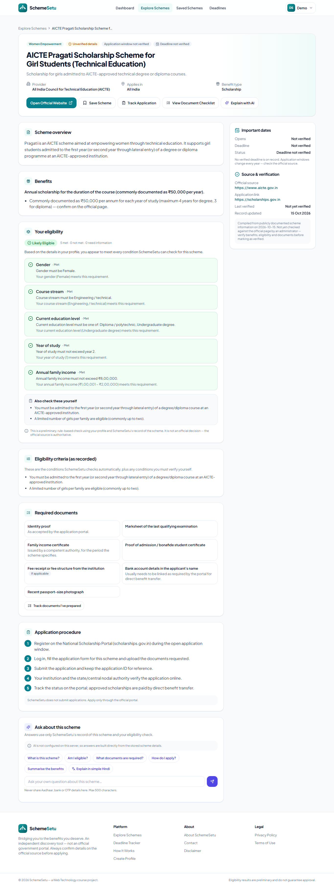 Likely-eligible breakdown |
| 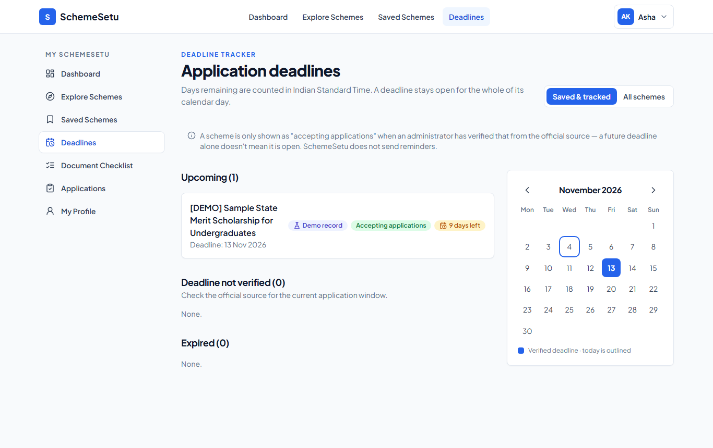 Deadline tracker | 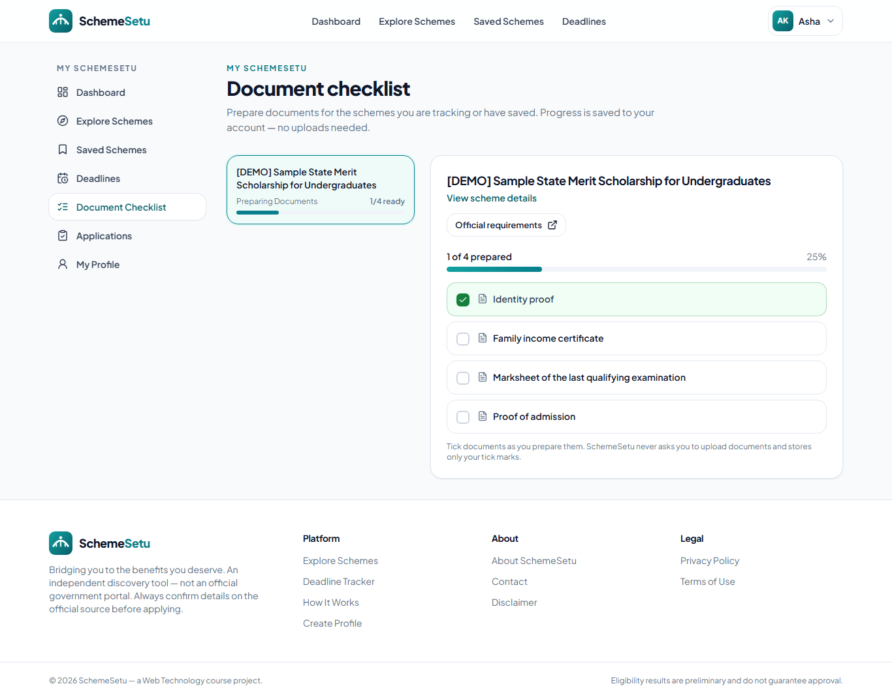 Document checklist |
| 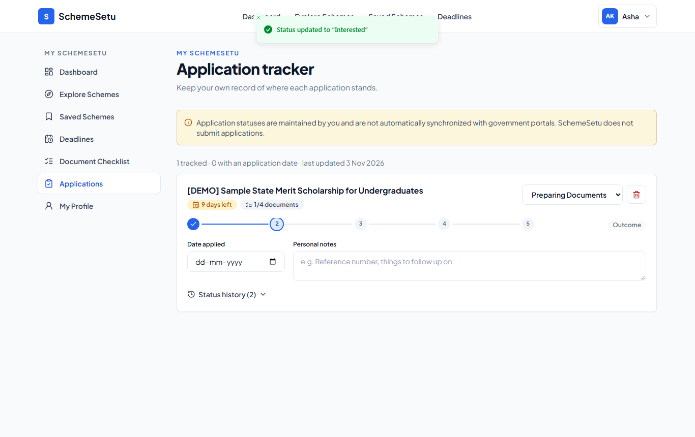 Application tracker | 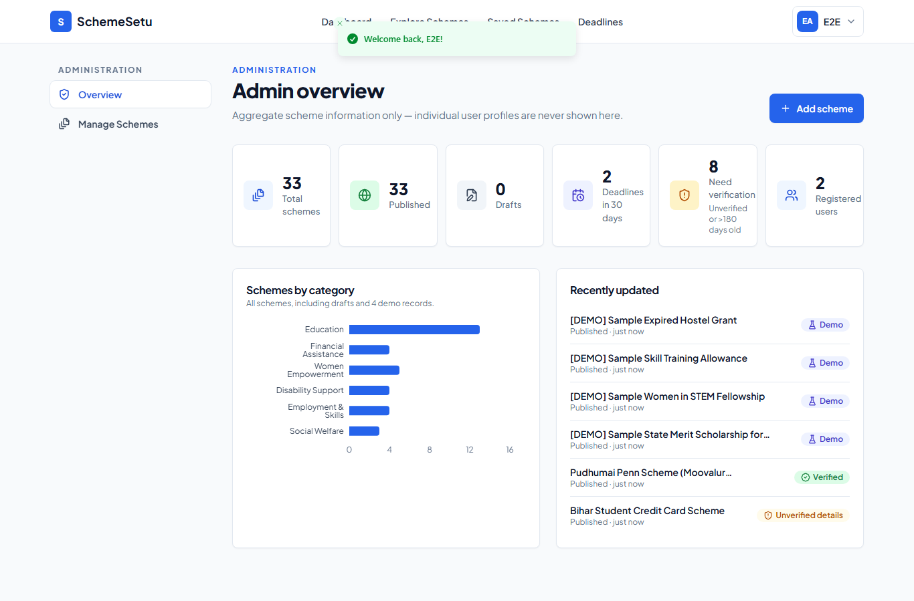 Admin dashboard |
| 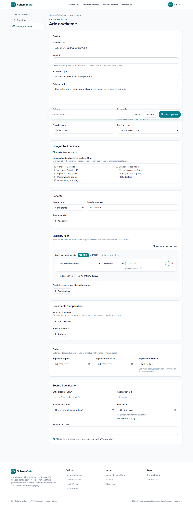 Admin editor & rule builder | 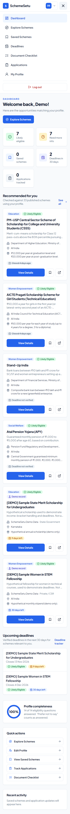 Mobile layout |

## Tech stack

**Frontend:** React 18, Vite 5, TypeScript, Tailwind CSS 3, React Router 6, TanStack Query 5, React Hook Form + Zod,
Framer Motion, Recharts 3, Lucide icons, Sonner toasts, self-hosted Plus Jakarta Sans + Noto Sans Devanagari.

**Backend:** Node.js (20+), Express 4, TypeScript, Mongoose 8, JWT (jsonwebtoken), bcryptjs, Zod, Helmet, CORS,
express-rate-limit, Pino structured logging.

**Database:** MongoDB (Atlas in production; local MongoDB or an embedded dev database locally).

**Tooling:** npm workspaces, ESLint, Prettier, Vitest, React Testing Library, Supertest,
mongodb-memory-server, Playwright.

## Architecture

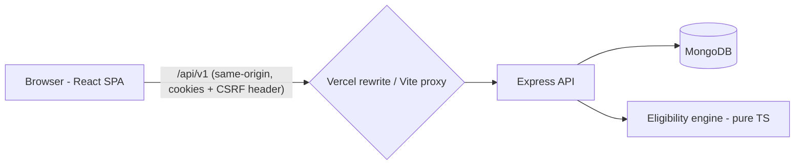

It's a modular monolith: one Express API and one React SPA. All business logic, including eligibility, lives on
the server in a single reusable service. See [docs/ARCHITECTURE.md](docs/ARCHITECTURE.md).

## Getting started (local)

**Prerequisites:** Node.js 20+ and npm 10+. MongoDB is optional, because an embedded development database can be used.

```bash
# 1. Install all workspaces
npm install

# 2. Create env files
cp server/.env.example server/.env      # then edit values (see below)
cp client/.env.example client/.env

# 3a. With your own MongoDB / Atlas: set MONGODB_URI in server/.env, then
npm run seed            # real scheme records
npm run seed:demo       # + clearly-labelled demo schemes (+ demo student if DEMO_USER_PASSWORD is set)
npm run create-admin    # needs ADMIN_EMAIL and ADMIN_PASSWORD in server/.env
npm run dev             # API on http://localhost:5000, web on http://localhost:5173

# 3b. Without MongoDB installed: set USE_EMBEDDED_MONGO=true in server/.env, then
npm run seed:demo && npm run create-admin
npm run dev:memory      # embedded MongoDB persisted to server/.data/mongo (dev only)
```

Open http://localhost:5173. In development, Vite proxies `/api` to the API, so the browser sees a single origin.

**Demo accounts.** None are committed. Create them yourself:

- Admin: set `ADMIN_EMAIL` and `ADMIN_PASSWORD` (12+ characters, letters and digits) in `server/.env`, then run `npm run create-admin`.
- Demo student: set `DEMO_USER_PASSWORD` and run `npm run seed:demo`. This creates `student@demo.schemesetu.local` with a fictional profile.
- Reset the demo data with `npm run seed:reset-demo -w server`.

## Environment variables

| Variable | Where | Required | Description |
|---|---|---|---|
| `NODE_ENV` | server | – | `development` / `test` / `production` |
| `PORT` | server | – | API port (default 5000) |
| `MONGODB_URI` | server | yes* | MongoDB connection string (*not needed with `USE_EMBEDDED_MONGO=true`) |
| `MONGODB_DB_NAME` | server | – | Database name (default `schemesetu`) |
| `USE_EMBEDDED_MONGO` | server | – | Development only: embedded MongoDB persisted to `server/.data/mongo` |
| `JWT_ACCESS_SECRET` / `JWT_REFRESH_SECRET` | server | prod | 32+ random characters each; the server refuses to start in production without them |
| `ACCESS_TOKEN_TTL_MINUTES` / `REFRESH_TOKEN_TTL_DAYS` | server | – | Token lifetimes (15 min / 7 days) |
| `CLIENT_URL` | server | yes | Allowed CORS origin(s), comma-separated |
| `COOKIE_SAMESITE` / `COOKIE_SECURE` | server | – | Cookie policy (see [DEPLOYMENT](docs/DEPLOYMENT.md)) |
| `TRUST_PROXY` | server | – | Proxies in front of the app (Render: `1`) |
| `LOG_LEVEL`, `RATE_LIMIT_ENABLED` | server | – | Logging / rate limiting |
| `ADMIN_EMAIL`, `ADMIN_PASSWORD`, `ADMIN_NAME`, `DEMO_USER_PASSWORD` | server (scripts) | – | Used only by `create-admin` and `seed:demo` |
| `VITE_API_BASE_URL` | client | – | API base as seen by the browser (default `/api/v1`) |
| `VITE_DEV_API_TARGET` | client | – | Dev proxy target (default `http://localhost:5000`) |

## Database & seed data

There are five collections: `users`, `schemes`, `savedschemes`, `applications` and `checklistprogresses`. See
[docs/DATABASE.md](docs/DATABASE.md).

- **29 real scheme records** (central and state) are in `server/src/seed/data/realSchemes.ts`. They were audited against
  official sources on 2026-10-16: **21 are verified** (with corrections applied) and **8 remain "needs review"** because
  the official source was unreachable or did not confirm the details. Deadlines are set only for the 9 schemes whose
  AY 2026-27 window is listed on the National Scholarship Portal. See [docs/SCHEME_SOURCES.md](docs/SCHEME_SOURCES.md).
- **4 demo schemes** are clearly prefixed `[DEMO]`, flagged `isDemo` and point to `example.org`. They exist to
  demonstrate deadlines and the "bracket crosses the limit" case.
- Seeding is idempotent (upsert by slug) and never overwrites admin edits unless you pass `--update`.

## Testing

```bash
npm test                    # backend (Vitest + Supertest + in-memory MongoDB) and frontend (Vitest + RTL)
npm run test:e2e            # Playwright: isolated API + in-memory DB + Vite dev server
npm run screenshots         # same, and writes docs/screenshots/*.png
npm run lint && npm run typecheck && npm run build
```

Last verified run: **98 backend tests and 12 frontend tests passed** (2026-11-04); the 4 end-to-end scenarios last passed on 2026-10-16. Details are in
[docs/TESTING.md](docs/TESTING.md).

## Deployment

Frontend on **Vercel**, API on **Render**, database on **MongoDB Atlas**. The recommended setup has Vercel rewrite `/api/*`
to Render, so auth cookies stay first-party. Step-by-step guide: [docs/DEPLOYMENT.md](docs/DEPLOYMENT.md).
There is a `render.yaml` blueprint in the repository root.

## API documentation

All endpoints, request and response shapes and error codes are in [docs/API.md](docs/API.md). The base path is `/api/v1`.

## Folder structure

```text
schemesetu/
├── client/                 React + Vite SPA
│   └── src/
│       ├── components/     common/ layout/ schemes/ forms/ dashboard/
│       ├── pages/          Landing Auth Onboarding Dashboard Schemes Saved Deadlines Checklist Applications Admin Info
│       ├── hooks/          TanStack Query hooks
│       ├── services/       fetch wrapper (CSRF, refresh) + typed endpoints
│       ├── context/        AuthContext
│       ├── types/ utils/ test/
├── server/                 Express API
│   └── src/
│       ├── config/ constants/ controllers/ middleware/ models/ routes/ validators/ utils/
│       ├── services/       eligibility/ recommendations/ schemeService authTokens
│       ├── seed/           seed.ts, createAdmin.ts, data/realSchemes.ts, data/demoSchemes.ts
│       └── tests/          unit + API tests, e2e API launcher
├── e2e/                    Playwright scenarios
├── docs/                   ARCHITECTURE API DATABASE TESTING DEPLOYMENT SCHEME_SOURCES PROJECT_REPORT screenshots/
├── render.yaml  playwright.config.ts  package.json (workspaces)  PROGRESS.md
```

## Team & contributions

This is a two-member team project. The table shows the **planned division of work**. Replace the placeholders
with your names and adjust it to reflect what each member actually did.

| Area | Member 1 — Frontend & UX (`<Name>`) | Member 2 — Backend & Intelligence (`<Name>`) |
|---|---|---|
| Setup | React/Vite/Tailwind app, design system | Express/TypeScript API, MongoDB models |
| Features | Landing, auth UI, onboarding, explorer, dashboard, saved, deadlines, checklist, applications, admin UI | Auth & sessions, scheme APIs, eligibility engine, recommendations, admin CRUD |
| Quality | Responsive design, accessibility, frontend tests | Validation, security, backend tests |
| Shared | API integration, E2E tests, deployment, documentation, report, screenshots, demo | ← same |

Suggested commit sequence: [docs/PROJECT_REPORT.md § Division of Work](docs/PROJECT_REPORT.md#19-division-of-work).

## Known limitations

- 8 of the 29 real scheme records are still **unverified** and need an admin to check them against official sources. Verified records should be re-checked periodically (the dashboard flags them after 180 days), as scheme rules and dates change every year.
- The engine checks only profile-checkable criteria. Other conditions are listed for the user to verify.
- Rate limiting uses an in-memory store, so limits are per instance. Use a shared store if you scale horizontally.
- Explorer filtering by eligibility evaluates the published catalogue in memory, which suits hundreds of schemes, not hundreds of thousands.
- There are no email or browser reminders, and the UI does not pretend otherwise.

## License

MIT for the source code. Scheme information belongs to the respective government sources. Always refer to them.
