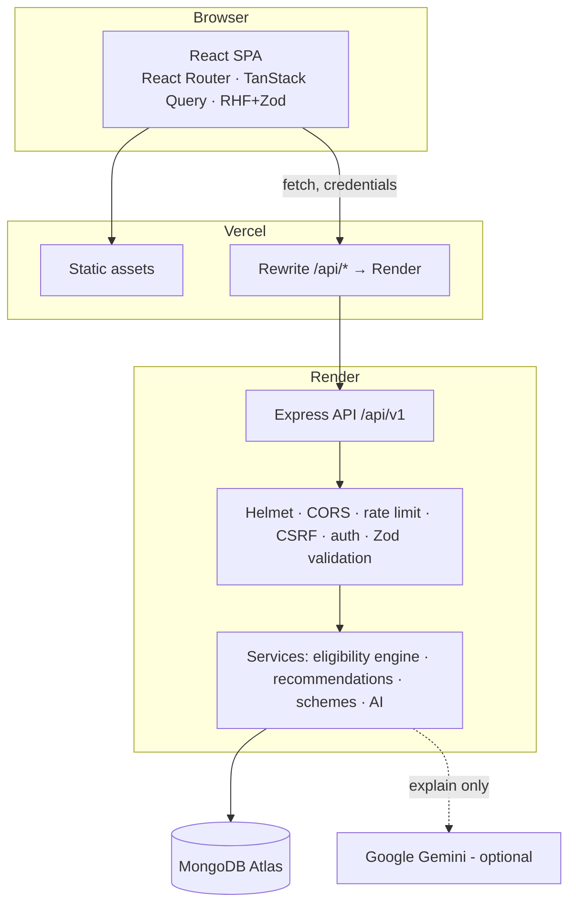

# Architecture

SchemeSetu is a **modular monolith**: one React single-page app and one Express API sharing one MongoDB database.
It has no microservices, queues or other infrastructure beyond those three pieces.

## Request lifecycle

1. The SPA calls `/api/v1/...` with `credentials: 'include'`. State-changing requests carry `X-CSRF-Token`.
2. Express runs Helmet security headers, a CORS allowlist (`CLIENT_URL`), JSON body limit (200 kb), cookie parser
   and request logging (method, path and status only).
3. `/api/v1` runs the global rate limiter, then **CSRF verification**: the header must equal the HttpOnly `ss_csrf`
   cookie, compared in constant time.
4. Route-level middleware: `requireAuth` / `optionalAuth` / `requireRole('admin')`, then `validate(zodSchema)`.
5. The controller calls services. Errors flow to the central `errorHandler`, which returns a consistent
   `{ success:false, error:{ code, message, details? } }` shape and never leaks stack traces.

## Authentication & sessions

| Token | Storage | Lifetime | Purpose |
|---|---|---|---|
| Access JWT (`ss_at`) | HttpOnly cookie, path `/api` | 15 min | Authenticates API calls (sub, role) |
| Refresh JWT (`ss_rt`) | HttpOnly cookie, path `/api/v1/auth` | 7 days | Issues new tokens via `POST /auth/refresh` (rotated) |
| CSRF token (`ss_csrf`) | HttpOnly cookie, plus a copy held in JS memory | 1 day | Synchroniser token for POST/PUT/PATCH/DELETE |

- Refresh tokens embed the user's `tokenVersion`. Logout increments it, which revokes all outstanding refresh tokens.
- `requireAuth` reloads the user on every request, so deleted accounts and role changes take effect immediately.
- On `401 TOKEN_EXPIRED` the client refreshes once (single-flight) and retries. If that fails, the session is cleared.
- Roles are never accepted from clients. Registration schemas are `.strict()`, and admins are created only by the
  `create-admin` script.

## Eligibility engine (`server/src/services/eligibility`)

- `facts.ts` normalises a profile into **facts**: an `enum` value, a numeric `range [min,max]` (exact values have
  min = max; income brackets are intervals), or `missing` (not provided or withheld).
- `engine.ts` evaluates a rule tree with **Kleene three-valued logic**:
  - AND: any FAIL → FAIL; all PASS → PASS; else UNKNOWN (empty AND = PASS)
  - OR: any PASS → PASS; all FAIL → FAIL; else UNKNOWN (empty OR = FAIL)
  - Leaf on a missing fact → UNKNOWN (never FAIL).
  - Numeric comparisons operate on intervals. For example, `[250001, 350000] ≤ 300000` gives UNKNOWN, so there's no midpoint guessing.
- State applicability is added automatically as a mandatory criterion for state-specific schemes.
- Status mapping: PASS → `LIKELY_ELIGIBLE`, FAIL → `NOT_ELIGIBLE`, UNKNOWN → `MORE_INFORMATION_NEEDED`. A scheme with no
  checkable rules is always `MORE_INFORMATION_NEEDED`. There are no percentages or scores.
- `ruleValidator.ts` validates rules as data: known fields, operators allowed for the field type, valid enum values,
  numeric ranges, group nesting ≤ 4 levels including the root, and no extra keys. Nothing is ever `eval`'d.
- One service is used everywhere: explorer, details, recommendations, dashboard and AI context.

## AI explainer (`server/src/services/ai`)

- The API is called server-side only. The key never reaches the browser.
- Context includes the scheme record and the engine's per-criterion results. The user's raw profile values and identity are **not** sent.
- The system instruction requires grounded answers only, forbids invented facts, guarantees or requests for identifiers,
  and tells the model to treat delimited data as untrusted. Delimiter tags inside data are neutralised.
- Safeguards: input ≤ 500 characters, output ≤ 2048 tokens (truncated to 4,000 characters), temperature 0.2, timeout,
  6 requests per minute and 60 per day per user.
- On any failure or a missing key, `fallback.ts` builds a deterministic answer from stored fields.

## Frontend structure

- Routes are lazy-loaded (`App.tsx`). Only the landing page is in the main chunk, and vendor libraries are split
  (react, query, motion, charts, forms).
- `services/api.ts` is the fetch wrapper. It handles CSRF, refresh-and-retry, timeouts and error normalisation.
- `hooks/queries.ts` holds TanStack Query hooks. Mutations invalidate dependent queries, and checklist toggles are optimistic with rollback.
- `GET /meta` provides profile options, eligibility field definitions and operators, so the server is the single source of truth.
- Accessibility: semantic landmarks, a skip link, labelled controls with `aria-describedby` errors, focus-trapping modals,
  `aria-live` status messages, visible focus rings and `prefers-reduced-motion` support (CSS plus `MotionConfig`).

## Scaling notes

- Explorer filtering and sorting by personal eligibility evaluates the published catalogue in memory per request.
  That's fine for hundreds of schemes. For much larger catalogues, pre-filter in MongoDB on indexed fields and cache evaluations.
- Rate limiting uses an in-memory store. With several API instances, switch to a shared store such as Redis.
