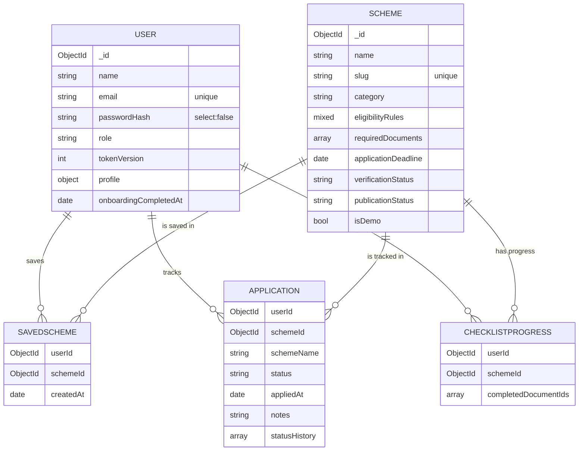

# Database Design (MongoDB + Mongoose)

## users

| Field | Type | Notes |
|---|---|---|
| name | string 2–80 | |
| email | string | unique, lowercase |
| passwordHash | string | bcrypt (12 rounds). `select:false`, and stripped from JSON. |
| role | `user` \| `admin` | indexed. Never settable through the API. |
| tokenVersion | number | `select:false`. Incrementing it revokes refresh tokens. |
| profile | subdocument | **All fields optional**: dateOfBirth / age, state, district, gender, residenceType, educationLevel, course, courseStream, institutionType, academicYear, previousExamPercentage, incomeBracket, annualIncome, socialCategory, minorityCommunity, disabilityStatus, employmentStatus, occupation. Enums are validated, and `prefer_not_to_say` / `unknown` mean "not disclosed". |
| onboardingCompletedAt | date \| null | |
| createdAt / updatedAt | dates | timestamps |

No Aadhaar, bank, phone or certificate data is ever stored.

## schemes

| Field | Type | Notes |
|---|---|---|
| name, slug (unique), shortDescription, description | strings | |
| category, providerType, benefitType | enums | indexed |
| tags, educationLevels | string[] | search and discovery filters |
| provider | string | |
| isAllIndia, applicableStates | bool, enum[] | Applicable states are enforced automatically by the engine |
| benefitSummary, benefits | string, string[] | |
| eligibilityRules | Mixed | Validated rule tree (see ARCHITECTURE). Data only, never executed. |
| additionalCriteria | string[] | Conditions users verify themselves |
| requiredDocuments | `[{ docId, name, description, optional }]` | **docId is stable**, which preserves checklist progress across edits |
| applicationSteps | string[] | |
| applicationOpenDate, applicationDeadline | Date \| null | Calendar dates stored at UTC midnight and interpreted as IST dates. `null` means not verified. |
| applicationWindowStatus | `open`/`upcoming`/`closed`/`not_verified` | Set by an admin from the official source |
| officialSourceUrl, applicationUrl | http(s) URLs | |
| sourceVerifiedAt, verificationStatus, verificationNotes | | `verified` requires a date. `demo` is used for hypothetical records. |
| isDemo | bool | Hypothetical demonstration record |
| publicationStatus | `draft`/`published` | Only published records are public |
| createdBy, updatedBy | ObjectId → User | |

Indexes: `slug` (unique), `{publicationStatus, category, applicationDeadline}`, `updatedAt`, and single-field indexes on
category, providerType, benefitType, verificationStatus, isDemo, publicationStatus and applicationDeadline.

## savedschemes

`{ userId, schemeId, createdAt }`, with a **unique compound index `{userId, schemeId}`** that prevents duplicate bookmarks.
Saves use idempotent upserts.

## applications

`{ userId, schemeId, schemeName (snapshot), status, appliedAt, notes ≤2000, statusHistory[{status, changedAt, note}] }`,
with a unique index on `{userId, schemeId}` and an index on `{userId, updatedAt}`. Every query is scoped to the current user.

## checklistprogresses

`{ userId, schemeId, completedDocumentIds[] }`, with a unique index on `{userId, schemeId}`. Only ids that the scheme
currently requires are stored and returned. Removed requirements drop out, and new requirements start unchecked.

## Integrity & deletion rules

- Referential checks: saving, tracking and checklist updates require the scheme to exist and be published.
- Deleting a scheme removes its bookmarks and checklist progress. Application records are kept, using the name snapshot, and are shown as "no longer available".
- Deleting an account removes the user and all their saved schemes, applications and checklists.
- Regex searches escape user input to prevent regex injection and ReDoS. Strict Zod schemas block operator injection such as `$where`.
