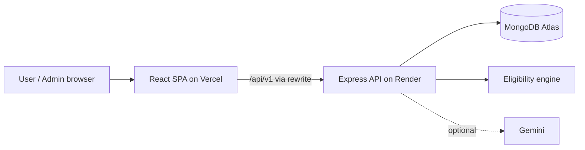

# SchemeSetu — A Personalised Scholarship & Welfare Scheme Discovery Platform

## 1. Title Page

| | |
|---|---|
| **Project title** | SchemeSetu — Bridging You to the Benefits You Deserve |
| **Course** | Web Technology — `<Course code>` |
| **Institution** | `<College / University name>` |
| **Team members** | `<Member 1 name, Roll no.>` · `<Member 2 name, Roll no.>` |
| **Guide / Faculty** | `<Faculty name>` |
| **Academic year** | `<2026–27>` |
| **Repository** | `<GitHub repository URL>` |

---

## 2. Abstract

Many students and citizens in India are eligible for government scholarships and welfare schemes but never apply. The
information is spread across many portals, eligibility rules are hard to interpret, and deadlines are easy to miss.
SchemeSetu is a full-stack web application that lets a user build one optional, privacy-conscious profile. It then
evaluates that profile against a curated database of schemes with a deterministic, explainable rule engine. For every
scheme the user sees which conditions they meet, which they don't, and which need more information. Missing or withheld
data is never treated as disqualifying, and income brackets are handled as intervals rather than guessed values. The
platform also offers search and filtering, saved schemes, a deadline tracker, document checklists, a personal application
tracker, an optional AI explainer grounded in the scheme record (Google Gemini, with a non-AI fallback), and an admin
content-management system with a visual AND/OR rule builder. It is built with React, TypeScript, Node.js/Express and
MongoDB, and is verified by 103 backend tests, 13 frontend tests and 4 browser end-to-end scenarios.

## 3. Introduction

Government welfare in India spans hundreds of central and state schemes: scholarships for school and college students,
support for persons with disabilities, women-focused programmes, skilling and employment schemes, pensions and income
support. Portals such as the National Scholarship Portal and myScheme exist, yet discovery remains difficult for a typical
student. SchemeSetu explores how good web engineering — clear data modelling, transparent logic and careful UX — can lower
that barrier while staying honest about what a non-official tool can and cannot do.

## 4. Problem Statement

People who may qualify for benefits face:

1. fragmented information across ministry, state and scholarship portals;
2. eligibility rules written in difficult terminology;
3. uncertainty about required documents and procedures;
4. missed deadlines; and
5. no single, personalised view of what applies to them.

Existing tools rarely explain *why* someone is or isn't eligible.

## 5. Objectives

1. Build a working full-stack application (frontend, backend and database) with at least six meaningful functions.
2. Provide personalised, explainable eligibility results without fabricated scores.
3. Handle missing or sensitive data respectfully, with all profile fields optional.
4. Help users prepare: checklists, deadlines and progress tracking.
5. Give administrators a safe way to maintain scheme data, with server-side access control.
6. Meet good standards of security, accessibility, testing and documentation.

## 6. Existing System and Limitations

| Existing approach | Limitation |
|---|---|
| Individual ministry and state portals | The user must already know which portal and scheme to look for |
| National Scholarship Portal | Built for application, not discovery; limited personal explanation |
| Generic search engines and blogs | Outdated or unverified information; no personalisation |
| Word of mouth, cyber cafés | Inconsistent, sometimes costly, may involve sharing sensitive documents |

## 7. Proposed System

SchemeSetu provides:

- one optional profile;
- rule-based matching with a three-valued result (Likely Eligible / Not Eligible / More Information Needed) and per-criterion explanations;
- a searchable directory;
- saving, deadlines, checklists and tracking; and
- an admin CMS.

Every scheme links to its official source, which remains authoritative. The tool never submits applications.

## 8. Technology Stack

| Layer | Technologies |
|---|---|
| Frontend | React 18, Vite, TypeScript, Tailwind CSS, React Router, TanStack Query, React Hook Form, Zod, Framer Motion, Recharts, Lucide, Sonner |
| Backend | Node.js, Express, TypeScript, Mongoose, JWT, bcryptjs, Zod, Helmet, CORS, express-rate-limit, Pino |
| Database | MongoDB (Atlas) |
| AI | Google Gemini via `@google/genai` (optional) |
| Testing | Vitest, Supertest, mongodb-memory-server, React Testing Library, Playwright |
| Deployment | Vercel (frontend), Render (API), MongoDB Atlas |

## 9. System Architecture

The backend follows a layered design: routes → middleware (security, authentication, validation) → controllers → services → models.
Details are in [ARCHITECTURE.md](ARCHITECTURE.md).

## 10. Functional Requirements

| ID | Requirement |
|---|---|
| FR1 | Users can register, log in, log out and delete their account |
| FR2 | Users can create and edit an optional eligibility profile through a four-step wizard |
| FR3 | The system evaluates every published scheme against the profile with stored rules |
| FR4 | Users can search, filter, sort and paginate schemes without logging in |
| FR5 | Users can view scheme details and a per-criterion eligibility breakdown |
| FR6 | Users can save and unsave schemes, with persistence |
| FR7 | Users can view upcoming, expired and unknown deadlines and a calendar |
| FR8 | Users can mark required documents as prepared, with persistence |
| FR9 | Users can track applications (status, date, notes, history) |
| FR10 | Users can ask grounded questions about a scheme (AI with fallback) |
| FR11 | Admins can create, edit, publish, unpublish and delete schemes and edit rules visually |
| FR12 | Admins see aggregate statistics without personal data |

## 11. Non-Functional Requirements

| Area | Approach |
|---|---|
| Security | bcrypt hashing; HttpOnly JWT cookies with refresh rotation and revocation; CSRF tokens; RBAC; Zod strict validation; Helmet; CORS allowlist; rate limiting; safe errors |
| Privacy | Data minimisation; no Aadhaar, bank or certificate data; optional fields; account deletion; no personal data in logs or admin views |
| Accessibility | Semantic HTML, labelled controls, keyboard support, focus-trapped modals, live regions, contrast, reduced motion |
| Performance | Route code-splitting, vendor chunking, query caching, indexed queries, lean projections, debounced search |
| Reliability | Loading, empty and error states; AI fallback; health check |
| Maintainability | TypeScript end to end, a single eligibility service, documented API, automated tests |

## 12. Database Design

There are five collections: `users`, `schemes`, `savedschemes`, `applications` and `checklistprogresses`. Unique compound indexes
prevent duplicates, and stable document ids keep checklist progress across edits. Full schema and ER diagram: [DATABASE.md](DATABASE.md).

## 13. Eligibility Matching Algorithm

**Input:** a scheme's rule tree (AND/OR groups of `{field, operator, value}`) and the user's profile.

1. **Normalise the profile into facts.** Each value becomes an enum, a numeric interval (income brackets become `[min, max]`;
   exact values become `[v, v]`; age comes from the date of birth in IST), or `missing` (not provided or "prefer not to say").
2. **Evaluate leaves.** A missing fact gives **UNKNOWN**. Numeric comparisons are interval-aware. For `x ≤ t`: PASS if `max ≤ t`,
   FAIL if `min > t`, otherwise UNKNOWN.
3. **Combine with Kleene logic.** AND: any FAIL → FAIL; all PASS → PASS; else UNKNOWN. OR: any PASS → PASS; all FAIL → FAIL;
   else UNKNOWN.
4. **Apply mandatory state applicability**, then combine everything with AND. The result maps to Likely Eligible, Not Eligible or
   More Information Needed. A scheme with no checkable rules is always "More Information Needed".
5. **Generate explanations.** These are the requirement text, the reason, the missing fields that could resolve UNKNOWN, and the
   conditions the user must check personally.

**Example:** bracket ₹2,50,001–₹3,50,000 against a limit of ₹3,00,000 gives **UNKNOWN**, with the prompt
"adding your exact income would resolve this". The engine does not guess a midpoint.

Rules are validated as data on every admin save and are never executed as code. The complexity is
O(number of rule nodes) per scheme.

## 14. API Design

The REST API is versioned under `/api/v1`, with a consistent JSON envelope, proper status codes, pagination and documented error codes.
It covers about 30 endpoints across auth, profile, schemes, saved, applications, checklists, AI and admin. See [API.md](API.md).

## 15. Module Descriptions

| Module | Description |
|---|---|
| Landing | Hero, how it works, features, categories, trust section with official portals |
| Authentication | Register and login forms with validation, password toggle, redirects, protected routes |
| Onboarding / Profile | Four-step wizard with a review step; edit page; profile completeness; account deletion |
| Dashboard | Computed counts, recommendations, deadlines, completeness, quick actions, activity, chart |
| Explorer | Debounced search, filter sidebar or mobile sheet, active-filter chips, sort, pagination, URL sync |
| Scheme details | Overview, benefits, eligibility breakdown, documents, steps, dates, verification, actions, AI panel |
| Saved / Deadlines / Checklist / Applications | Personal productivity pages backed by MongoDB |
| Admin | Statistics with a chart, scheme table, editor with rule builder, publish workflow, safe delete |
| Eligibility engine | Pure TypeScript service with a validator and explanations |
| AI service | Prompt building, injection defences, timeout, fallback |

## 16. Implementation Details

- **Authentication:** cookies scoped by path; CSRF synchroniser token; silent refresh on `TOKEN_EXPIRED`.
- **Dates:** scheme dates are calendar dates evaluated in IST, so a deadline remains open for its whole day.
- **Honesty rules in code:** a scheme is shown as "Accepting applications" only if an admin set it so, and a passed deadline
  overrides that. Demo records are labelled everywhere. A "verified" status requires a verification date.
- **Seed:** idempotent upserts by slug. Real and demo data are separated, and there is a resettable demo dataset.

## 17. Testing and Results

Results from the run on 2026-10-15 are summarised in [TESTING.md](TESTING.md):

- backend: 103 tests passed;
- frontend: 13 tests passed;
- Playwright: 4 end-to-end scenarios passed (new user, admin, security, explorer/mobile);
- lint and type checks are clean; production builds succeed.

AI with a real Gemini key and the live cloud deployment were **not** tested because credentials were unavailable.

## 18. Screenshots

These were captured from the running application by the automated Playwright run (`npm run screenshots`):

| Screen | File |
|---|---|
| Landing page | `screenshots/01-landing.png` |
| Registration | `screenshots/02-register.png` |
| Profile onboarding | `screenshots/03-onboarding.png` |
| Dashboard | `screenshots/04-dashboard.png` |
| Scheme explorer | `screenshots/05-explorer.png` |
| Scheme details + eligibility (more info needed) | `screenshots/06-scheme-details-eligibility.png` |
| Eligibility matching (likely eligible) | `screenshots/07-eligibility-likely.png` |
| Deadline tracker | `screenshots/08-deadlines.png` |
| Document checklist | `screenshots/09-checklist.png` |
| Application tracker | `screenshots/10-applications.png` |
| Admin dashboard | `screenshots/11-admin-dashboard.png` |
| Admin scheme editor / rule builder | `screenshots/12-admin-editor.png` |
| Mobile layout | `screenshots/13-mobile-menu.png` |

For the login page, open `/login` and capture it manually; it shares its layout with registration.

## 19. Division of Work

This is the **planned** split. Edit it to reflect what each member actually did.

| Member 1 — Frontend & UX | Member 2 — Backend & Intelligence |
|---|---|
| React/Vite/Tailwind setup, design system | Express/TypeScript setup, MongoDB schemas |
| Landing, authentication UI, onboarding wizard | Authentication, sessions, CSRF, RBAC |
| Explorer, scheme details, dashboard | Scheme APIs, search, filtering, pagination |
| Saved, deadlines, checklist, applications UI | Eligibility engine and recommendations |
| Admin UI and rule builder | Admin CRUD APIs, seed scripts, AI service |
| Responsive design, accessibility, frontend tests | Validation, security, backend tests |

**Shared:** API integration, Playwright E2E, deployment, documentation, this report, screenshots and the demo.

**Suggested commit sequence** (each member commits their own work):

1. `chore: scaffold monorepo, server and client toolchains` (M1 + M2)
2. `feat(server): config, logger, error handling, health check` (M2)
3. `feat(server): user model, auth with httpOnly JWT cookies and CSRF` (M2)
4. `feat(client): design system, layout, navbar, footer` (M1)
5. `feat(client): login and register pages` (M1)
6. `feat(server): profile API and options metadata` (M2)
7. `feat(client): onboarding wizard and profile page` (M1)
8. `feat(server): scheme model, public scheme APIs, seed data` (M2)
9. `feat(server): three-valued eligibility engine with tests` (M2)
10. `feat(client): explorer, scheme details, eligibility breakdown` (M1)
11. `feat: saved schemes, applications, checklists (API + UI)` (M1 + M2)
12. `feat: dashboard and deadline tracker` (M1 + M2)
13. `feat: admin CMS with rule builder` (M1 + M2)
14. `feat(server): AI explainer with fallback` (M2)
15. `test: e2e scenarios; docs: README, API, report` (M1 + M2)

## 20. Challenges and Limitations

- **Data verification.** Official portals are often client-rendered, scanned PDFs or geo-restricted. An audit on 2026-10-16
  verified 21 of the 29 real records against official guidelines and portals (correcting several rules and amounts); the
  other 8 remain "needs review" for administrators. Deadlines are set only where the National Scholarship Portal states them.
- **Uncertain eligibility.** Income brackets and missing data required three-valued logic instead of a simple yes/no.
- **Cross-site cookies.** These were solved by proxying `/api` through Vercel.
- **Limitations.** Profile-checkable criteria only; in-memory rate limits; no reminders; Hindi only via AI.

## 21. Future Scope

- Admin workflow for periodic re-verification, with links checked by a scheduled job.
- Opt-in email or push deadline reminders.
- A full Hindi and regional-language interface (i18n).
- Saved filter alerts ("notify me about new schemes I'm likely eligible for").
- Integration with official APIs, if and when they are published.
- Optional DigiLocker-style document readiness hints, still without storing documents.

## 22. Conclusion

SchemeSetu shows that a two-person team can build a complete, secure and accessible full-stack platform that addresses a real
social problem. Its central contribution is a transparent, three-valued eligibility engine that never invents certainty. Together
with honest data labelling and careful UX, it helps people understand and prepare for the benefits they may deserve.

## 23. References

1. National Scholarship Portal — https://scholarships.gov.in
2. myScheme, Government of India — https://www.myscheme.gov.in
3. National Portal of India — https://www.india.gov.in
4. Official scheme sources listed in [SCHEME_SOURCES.md](SCHEME_SOURCES.md)
5. React — https://react.dev · Vite — https://vitejs.dev · Express — https://expressjs.com · MongoDB / Mongoose — https://mongoosejs.com
6. OWASP Cheat Sheet Series (Authentication, CSRF, Session Management) — https://cheatsheetseries.owasp.org
7. W3C Web Content Accessibility Guidelines 2.2 — https://www.w3.org/TR/WCAG22/
8. Kleene, S. C. — three-valued logic (strong Kleene logic)

## 24. GitHub Repository Link

`<https://github.com/<username>/schemesetu>`

---

### Appendix A — Demo script (3–5 minutes)

1. **Landing (20 s):** headline, how it works, the honesty and official-portals section.
2. **Register and onboarding (60 s):** show the optional fields, "Prefer not to say", and the review step.
3. **Dashboard (30 s):** computed counts and recommendations.
4. **Scheme details (60 s):** open *[DEMO] Sample State Merit Scholarship*. Point out the per-criterion breakdown and the income
   bracket that crosses the ₹3,00,000 limit ("More information needed"). Then open *AICTE Pragati* for "Likely Eligible", and a
   scheme with a failed criterion such as *PM-KISAN* (the demo student's occupation is not "farmer").
5. **Save, track and checklist (40 s):** save, track, tick documents, and change the status in the Application tracker.
6. **Deadlines (15 s):** upcoming and expired lists, and the calendar.
7. **AI explainer (20 s):** ask "What documents are required?" (AI, or the labelled fallback).
8. **Admin (60 s):** log in as admin, edit the demo scheme's income rule in the rule builder, save, and show the student's result change.
   Unpublish it and show it disappear from the explorer.
9. **Architecture (30 s):** React SPA → Express API → MongoDB, the eligibility service, and the test results.

Reset the demo data before presenting with `npm run seed:reset-demo -w server`.
